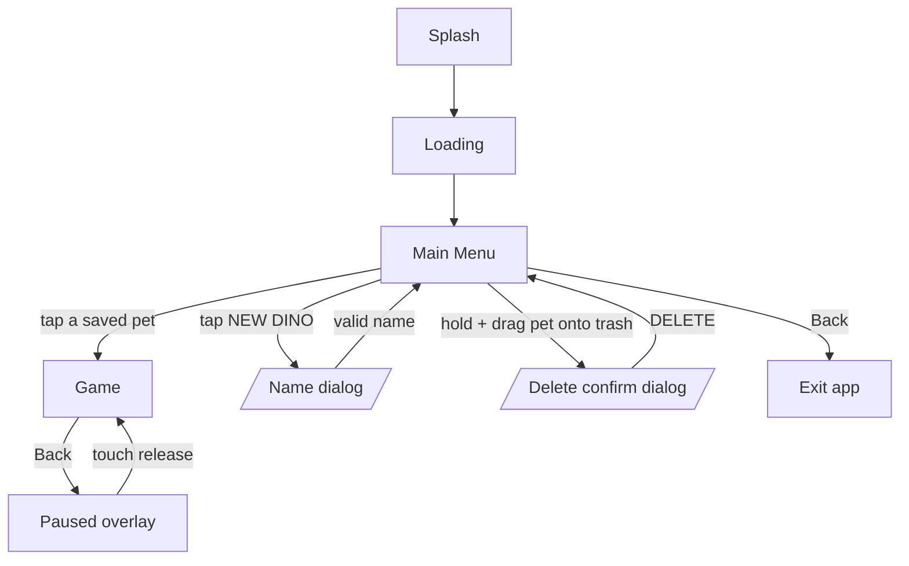

# 2. Screens & flows

Source: `RakurakuLauncher`, `SplashLoadingScreen`, `LoadingScreen`, `MainMenuScreen`, `GameScreen`.

## 2.1 Screen graph

There is **no route from the Game screen back to the Menu** (BUG-07) — a limitation to resolve in the web version.

## 2.2 Boot: splash and loading

- `BOOT-01` ✅ **Splash**: black background, `splash.png` (234 × 149) drawn at (0,0). Splash/progress-bar assets are loaded here, then the loading screen takes over immediately.
- `BOOT-02` ✅ **Loading**: runs as a 5-step state machine (one step per frame), drawing a progress bar that fills `step × 230/5` px. It loads the device art, pixel-matrix dino, food and stat images, sounds, and all 1-year action sprites and feeding animations. The exact grouping per step doesn't matter for the web build.
- `BOOT-03` ✅ Loading creates the SQLite database if missing (see [05](05-persistence.md)), loads the **Fredoka** font, and then opens the Main Menu.
- `BOOT-04` 💤 A background theme (`gato_chrono.mp3`, looping, volume 0.85) is wired up but **commented out**.
- 🆕 In the web build, loading is real asset preloading + service-worker precache.

## 2.3 Main menu

### Layout

- Background colour `rgb(125,125,180)`. Faint decorative art: the *baby-dino-add* logo centered and the splash logo flipped vertically below it.
- Text: Fredoka, white with a 4 px black outline. Title is 1.5× the base text size (base = 40 px).
- Portrait: title on two lines ("Select your" / "Rakuraku Dino"); a full-width **NEW DINO** button; below it the pets as a **vertical list** (one per row, 180 px tall buttons).
- Landscape: title on one line ("Select your Rakuraku Dino"); **NEW DINO** button with side padding 170 px; pets as a **2-column grid** (235 px tall buttons).
- Buttons are 9-slice (left cap + stretchable fill + right cap). Each pet button shows **only the pet's name**, centered, no icon, age or status.
- Pet order = insertion order (rowid; no sort). `MENU-01` ✅

### Rules

| ID | Rule | Status |
|----|------|--------|
| MENU-02 | At most **4** pets can exist (`MAX_DINOS_ALLOWED = 4`). | ✅ |
| MENU-03 | **Tap** a pet button → open that pet in the Game screen. A press that's dragged off the button before release is cancelled. | ✅ |
| MENU-04 | Pressing a button darkens it (black, alpha 100) while held. | ✅ |
| MENU-05 | **Tap NEW DINO** → name dialog (see below) if fewer than 4 pets. | ✅ |
| MENU-06 | **Tap NEW DINO when 4 pets exist** → nothing happens at all. | 🐞 BUG-08 |
| MENU-07 | **Rotating the device** resets all transient menu state (pressed, drag in progress) and recomputes layout. | ✅ |
| MENU-08 | **Back** on the menu exits the app. | ✅ |

### Create-pet dialog

- Title **"Enter your dino's name"**; one single-line text field with the same hint; auto-capitalize each word; **max 15 characters**; buttons **OK** / **Cancel**.
- `MENU-09` ✅ Empty name → toast **"You must provide a valid name"** and no pet is created.
- `MENU-10` ✅ Name that already exists (exact, **case-sensitive** match) → toast **"`<name>` already exists!"**.
- `MENU-11` ✅ Success → toast **"`<name>` created."**; the new pet appears in the list. The player is **not** taken into the game automatically; they must tap the new pet.
- `MENU-12` 🟡 Whitespace-only names pass the "empty" check (only `isEmpty()` is tested; no trim). Names are the pet's unique key.

### Delete-pet flow (long-press and drag to a trash zone)

1. `DEL-01` ✅ **Hold** a pet button (the hold threshold lives in the missing game framework, so the exact duration is unknown; git history shows it was tuned once) → the device **vibrates 50 ms** and **drag mode** starts.
2. `DEL-02` ✅ In drag mode: the screen dims (black, alpha 192); the NEW DINO button is replaced by a red **trash** button in the same place (pulsing alpha 40 ↔ 240 over 500 ms); the held pet button follows the finger (anchored by the grab offset) and pulses alpha 40 ↔ 255 over 1500 ms. The original slot is left empty while dragging.
3. `DEL-03` ✅ Dragging **onto** the trash zone vibrates again (once per entry) and tints the dragged button red. Leaving and re-entering vibrates again.
4. `DEL-04` ✅ **Releasing over the trash** → confirmation dialog: title **"WARNING!"**, body **`do you really want to delete "<name>" from your saved dinos?`**, buttons **DELETE** / **Cancel**.
5. `DEL-05` ✅ **DELETE** removes the pet permanently and refreshes the list. **Cancel** just closes the dialog.
6. `DEL-06` ✅ **Releasing anywhere else** cancels drag mode with no changes.

Delete is the **only** way to remove a pet; there is no other management UI (no rename, reorder, or export).

## 2.4 Game screen

- `GAME-01` ✅ Opening a pet from the menu immediately shows the device in the **Idle** state (there's a "Ready" state that auto-advances on the first frame).
- `GAME-02` ✅ **Idle display**: the pet is drawn on the LCD as a 1-bit **pixel matrix** (19 columns × 16 rows, each pixel an 8 × 8 px black square at alpha 150, no gap), animated between 2 frames, **750 ms** each. The pet type shown is the "3-year bronto" matrix regardless of the real age (the pixel data for a 1-year and 2-year pet exists but is not loaded).
- `GAME-03` ✅ The pet's stats are held in memory only while the screen is open. Opening a pet always starts from default stats (see [04](04-pet-state.md)), regardless of what the pet had before.
- `GAME-04` ✅ **Pause**: Android Back → "Paused": screen dims (black, alpha 155), game updates stop; **any touch-up** resumes. (The framework probably also calls `pause()` when the app is backgrounded, but that code isn't in the archive.)
- `GAME-05` 🐞 There is no in-game way to return to the menu (BUG-07).
- `GAME-06` ✅ The debug buttons from [00](00-overview.md) are present.
- Action state machines: see [03-actions](03-actions.md).
