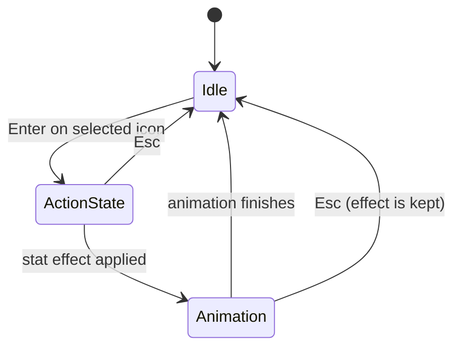
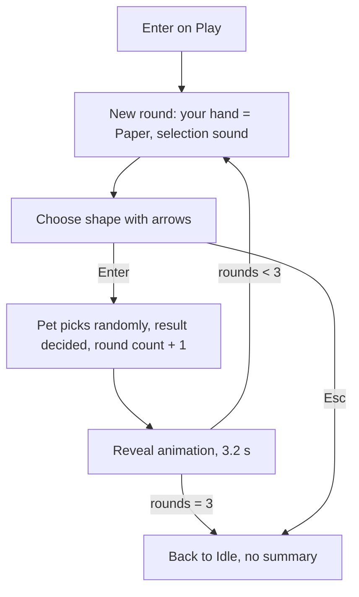

# 3. Actions

Source: `GameScreen.handleButtons` / `handleUpdates`, `models/*`.
All durations are in ms. An animation "of N loops" has total duration = `Σ frame durations × N`.

## 3.0 Common action lifecycle

- `ACT-01` ✅ Every action starts only from **Idle**, via Enter on the selected icon.
- `ACT-02` ✅ There are **no cooldowns, no cost, and no "not needed" refusals** on any action. The player can feed, drink, study, or pet repeatedly. Stats simply saturate (or stop at the top of their scale).
- `ACT-03` ✅ The only "refusal" in the whole game is the head-shake (*negate*) when giving medicine to a healthy pet.
- `ACT-04` ✅ Eating and drinking are always followed by a **burp** animation.
- `ACT-05` 🐞 Effects are applied at the *start* of the action. Esc cancels the animation but not the effect (BUG-05).

## 3.1 Drink 💧 (left col, row 0)

| ID | Rule | Status |
|----|------|--------|
| DRINK-01 | Enter → `thirst += 1`, capped at **8**. The stat is applied immediately. | ✅ |
| DRINK-02 | Animation: 7 frames × 75 ms, 1 loop (≈525 ms), the pet drinking from a glass/straw. | ✅ |
| DRINK-03 | Then the **burp** animation (see §3.9). | ✅ |
| DRINK-04 | Drinking while at max thirst is allowed (no refusal). | ✅ |

> `thirst` follows the same convention as hunger: 0 = 4 empty glasses, 8 = 4 full glasses (`stat_drink0…8`, verified against the art).

## 3.2 Food 🍔 (left col, row 1)

### Food selection

Enter on Food opens a **selector**: the LCD shows the currently chosen food sprite. Left/right arrows cycle; Enter confirms; Esc cancels.

- `FOOD-01` ✅ Six foods in a fixed ring. **Right arrow = next**, **Left arrow = previous**, wrapping:

  `Hamburger → Chicken → Apple → Carrot → Ice Cream → Noodles → (Hamburger)`

- `FOOD-02` ✅ Initial selection is **Hamburger**. The selection is remembered between feedings in the same session.

### Effects (applied on Enter, before the animation)

| Food | Fullness (`hunger`) | Other | Meal size name | Status |
|------|---------------------|-------|----------------|--------|
| Apple | +1 | | HalfMeal | ✅ |
| Hamburger | +1 | | HalfMeal | ✅ |
| Carrot | +2 | | FullMeal | ✅ |
| Chicken | +2 | | FullMeal | ✅ |
| Noodles | +2 | | FullMeal | ✅ |
| Ice Cream | **+0** | **39% chance of weight +1** (see BUG-03) | IceCream | 🟡 |

- `FOOD-03` ✅ Fullness is capped at **8**.
- `FOOD-04` ✅ Weight **only** increases through Ice Cream; it is never reduced. There is no cap in code (BUG-02).
- `FOOD-05` 💤 The DB has `noodles_eaten`, `veggies_eaten`, `meat_eaten` counters (never written). **Confirmed purpose:** they decide the species (T-Rex = Chicken Thigh/Hamburger, Brontosaurus = Carrot/Apple, Triceratops = mostly Noodles). See SPEC-01…05 in [08](08-target-rules.md).
- `FOOD-06` 🟡 A TODO in `Dino.eat` says "tratar aumento de peso" ("handle weight gain") — the weight rules are admittedly unfinished.

### Eating animation (2 loops, except Noodles = 3)

| Food | Frames | ms/frame | Total |
|------|--------|----------|-------|
| Apple | 3 (food, bite 1, bite 2) | 100 | 600 |
| Carrot | 4 | 100 | 800 |
| Chicken | 4 | 75 | 600 |
| Hamburger | 4 | 75 | 600 |
| Ice Cream | 4 | 75 | 600 |
| Noodles | 2 | 75 | 450 (3 loops) |

The first frame of each animation is the plain food sprite shown in the selector, so the selector → eating transition is seamless. After the animation, the **burp** plays (§3.9).

## 3.3 Lamp 💡 (left col, row 2) — 💤 not implemented

- Icon `lamp.png` and two full-screen sprites `sleep_1_1.png`, `sleep_1_2.png` (a sleeping pet with a "z") exist.
- `LampControl` state is entered by Enter, draws nothing, ignores input, and only Esc leaves it (BUG-06).
- Intended behavior (sleep / lights on-off, sleep schedule, whether a sleeping pet's needs freeze) is unknown → open questions.

## 3.4 Pet ❤️ (left col, row 3)

| ID | Rule | Status |
|----|------|--------|
| PET-01 | Enter → mood improves by **one step**: VerySad → Sad → Normal → Happy → VeryHappy (max). | ✅ |
| PET-02 | Animation: 2 frames × 50 ms, 1 loop = **100 ms** (a brief flicker; probably a placeholder duration). | ✅ |
| PET-03 | Unlimited repetition: five Pet presses from VerySad reach VeryHappy. | ✅ |

## 3.5 Check 🔍 (left col, row 4)

A read-only status viewer. Created fresh each time Enter is pressed on Check, starting at the **Mood** screen.

- `CHECK-01` ✅ Right arrow → next screen; Left arrow → previous; both **wrap**. Order:

  `Mood → Education → Weight/Age → Hunger → Thirst → Temperature → (Mood)`

- `CHECK-02` ✅ Screens:

| Screen | Shows | Source images |
|--------|-------|---------------|
| Mood | One of 5 faces | `stat_face_{verysad, sad, normal, happy, veryhappy}` |
| Education | Grade letter **C+ / B+ / A+** | `stat_education_{c,b,a}plus` |
| Weight / Age | Three layered images: a base, the age number, the weight number | `stat_age_weight_base`, `stat_age1`, `stat_weight1…3` |
| Hunger | **4 bowls**, each empty/half/full: value 0–8 = 0–4 bowls | `stat_food0…8` |
| Thirst | **4 glasses**, same 0–8 scale | `stat_drink0…8` |
| Temperature | Thermometer + "NN°C" | `stat_temperature_{15,20,25,30,35}` |

- `CHECK-03` 🐞 The temperature screen always shows 15° (BUG-01).
- `CHECK-04` 🐞 Age or weight outside the sprite range crashes (BUG-02). The assets only cover age 1 and weight 1–3.
- `CHECK-05` ✅ Check never changes pet state and has no animation.

## 3.6 Play 🎮 — Jokenpo (right col, row 0)

A Rock-Paper-Scissors minigame against the pet. **Fixed 3 rounds.**

### Flow

| ID | Rule | Status |
|----|------|--------|
| PLAY-01 | Each round starts with the player's hand reset to **Paper**. | ✅ |
| PLAY-02 | **Left arrow** cycles Paper → Rock → Scissors → Paper. **Right arrow** cycles Paper → Scissors → Rock → Paper. Each press plays the *selection* sound (and the normal beep). | ✅ |
| PLAY-03 | **Enter** plays the *evaluate* sound and locks the shape. The pet's shape is **uniformly random** (⅓ each). | ✅ |
| PLAY-04 | Standard rules: Rock beats Scissors, Scissors beats Paper, Paper beats Rock. Equal = tie. | ✅ |
| PLAY-05 | Ties **still use up a round** (always exactly 3 rounds, never replayed). | ✅ |
| PLAY-06 | Reveal timeline from the moment of Enter: **0–1400 ms** pet's hand only; **1400–3200 ms** both hands shown; **after 3200 ms** the LCD is blank, then the next round starts (or the game ends). | ✅ |
| PLAY-07 | At the start of the "both hands" phase, one sound plays: pet wins → *win* sound; player wins → *loss* sound; **tie → *loss* sound** (BUG-10). | ✅ |
| PLAY-08 | Wins are tallied per side during the game (`dinoWins`, `humanWins`) — but never shown. After round 3 the game just returns to Idle. No winner announcement. | 🟡 |
| PLAY-09 | **No stat is affected by Play**, win or lose. (No mood change, no weight loss, no `last_play` update.) | 🟡 |
| PLAY-10 | Esc at any time abandons the game with no penalty. | ✅ |

The code has `// TODO switch placar, etc....` (scoreboard) and `// the game is over, handle animations of win/loss` — both unfinished.

The `last_play` timestamp and `happiness` column suggest Play was meant to raise mood and/or affect weight — unconfirmed → open questions.

## 3.7 Educate 📚 (right col, row 1)

| ID | Rule | Status |
|----|------|--------|
| STUDY-01 | Enter → education improves one step: **C+ → B+ → A+** (max). Initial value is C+. | ✅ |
| STUDY-02 | Animation: 2 frames × 75 ms, 2 loops = **300 ms**. | ✅ |
| STUDY-03 | Unlimited repetition; no cooldown (`last_study` timestamp exists, unused). | ✅ |
| STUDY-04 | A lower grade D+ was considered and then commented out. | 💤 |

## 3.8 Bath 🛁 and Cool ❄️ (right col, rows 2–3) — 💤 not implemented

- **Bath**: icon `bath.png`, `DIRTY` pet state, `dirty` and `last_bath` columns. Enter → empty `Bathing` state (BUG-06). A code comment mentions pet *"cocozinhos"* (little poops) on the idle screen. No poop sprite exists.
- **Cool**: icon `cool.png`, `COLD` and `HOT` pet states, `temperature_up()` / `temperature_down()` (±5 °C, range 15–35) are implemented in `Statistics` but **never called**. Enter → empty `CoolingControl` state. Note there is no "heat" action icon, so how temperature rises is unknown.

## 3.9 Medical 💊 (right col, row 4)

| ID | Rule | Status |
|----|------|--------|
| MED-01 | If the pet is **SICK**: state becomes NORMAL immediately; medicate animation of 4 frames × 100 ms, 1 loop = **400 ms**. | ✅ |
| MED-02 | If the pet is **not sick** (any other state, including DIRTY/HOT/COLD): *negate* animation (head shake), 2 frames × 500 ms, 2 loops = **2000 ms**. Nothing changes. | ✅ |
| MED-03 | Medicine is always successful: no doses, no chance, no side effects. | ✅ |
| MED-04 | Medicine only cures SICK; it is ignored by every other state. | ✅ |
| MED-05 | The only way to become SICK in the legacy build is the debug button. | 🟡 |

## 3.10 Burp (shared)

After Drink and Food: 2 frames × 750 ms, 2 loops = **3000 ms**. Frame 0 is the idle sprite, frame 1 is a burping sprite. This is the longest non-interactive animation in the game; it can be skipped with Esc.
