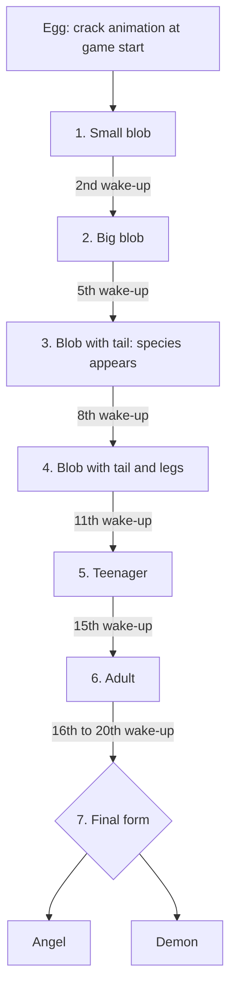

# 8. Target rules (decided design)

This document holds rules **decided with you**, as opposed to docs 00–06 which describe what the legacy Android code did. Where the two conflict, **this document wins.**

Sources: your answers (see the decisions log in [07](07-open-questions.md)), based on your memory of the physical toy. Claims from the third-party blog guide live in [12](12-blog-guide-review.md) until you confirm them.
Items marked 🔶 are my interpretation or a proposed default and can be changed. Items marked ❓ are still unknown. Every number marked **tunable** lives in a config file, not in the logic.

## 8.1 Guiding principles

| ID | Principle |
|----|-----------|
| GOAL-01 | Follow the **look, feel and rules of the physical toy** as remembered/verified by you. Iterate on UI details freely, but don't invent mechanics the toy didn't have unless we decide so. |
| GOAL-02 | Where neither the toy nor your memory gives an answer, use the *proposed default* from the open questions and keep the value **tunable**, so it can be changed after play-testing. |
| PACE-01 | **Pacing principle:** every need meter (hunger, thirst, happiness, education) is tuned so the player must interact **at least twice a day** to keep it out of a bad condition. The exact decay rates and per-interaction amounts are derived from this target and kept **tunable**. An automated test should encode it (two interactions per day keep the pet healthy; one starts causing conditions; none escalates). | ✅ |
| NEED-01 | **Hunger and thirst meters range from 0 to 8**, shown as **4 bowls / 4 glasses** that can each be empty, half or full (so one step = half an icon). **0 = completely empty** (the pet is HUNGRY / THIRSTY), **8 = full**. This matches the legacy code (both stats are capped at 8; stat images 0–8) and the blog's photos. | ✅ confirmed |
| NEED-02 | Meal sizes (from the legacy, to verify on the toy): half meals (Apple, Hamburger) **+1**, full meals (Carrot, Chicken Thigh, Noodles) **+2**, a drink **+1**, Ice Cream **+0** hunger. Thresholds that count as HUNGRY / THIRSTY are ❓ tunable. | 💤 legacy / ❓ thresholds |
| ASSET-01 | **All art, animation, sound and fonts are created from scratch.** Nothing from the legacy Android project is reused (no sprites, shell, logo, sounds, or font). The legacy assets are only a *reference for behavior* (frame counts, timings, layout). |
| ASSET-02 | `gato_chrono.mp3` and the legacy sound effects are **not** included; sounds are synthesized (SND-02). | ✅ |
| ASSET-03 | New art should evoke the toy's feel (1-bit LCD, egg-shaped shell) but be an **original** design, not a copy of the commercial toy's artwork, logo or mascot. The legacy shell art appears to be the product's promotional art ([12 §12.5](12-blog-guide-review.md)). |
| I18N-01 | The app is **multilingual**: **pt-BR is primary** (and the source of truth for all text), **English** ships alongside, **Latin American Spanish (es-419)** comes later. The core and the art contain no user-facing text. Details: [14](14-localization.md). | ✅ decided |
| ASSET-04 | Art is delivered **in waves** (you draw the sprites). The stage logic is built first and must work with placeholder art, and any missing sprite must fall back to the closest available one. See [10](10-art-spec.md). |

## 8.2 Time model

| ID | Rule | Status |
|----|------|--------|
| TIME-01 | The pet lives in **real time**. When the app opens, the elapsed time since the last save is simulated in chronological order, applying every rule (stat decay, dirtiness, illness, care-score accrual, growth at morning wake-ups, death) exactly as if the app had been running. | ✅ decided |
| TIME-02 | The simulation must be **deterministic** given the pet's state, a time interval, and a per-pet random seed stored with the pet. It steps through the interval (not jumps), because events inside it change later behavior (a morning growth changes needs; six hours of sickness leads to death). Reloading the app must never change the outcome of random draws. | 🔶 consequence |
| TIME-03 | Neglect while away has real consequences, including death, but sleeping hours should be gentle so a normal night away doesn't kill the pet. How gentle: check against the toy ([09](09-toy-verification-checklist.md)). | 🔶 |
| TIME-04 | Clock edge cases: if `now < lastSavedAt` (clock set back), elapsed = 0. Elapsed durations use UTC; "wake time" and "night" use local wall-clock time. | 🆕 proposed |
| TIME-05 | The **wake-up time** is user-configurable, within **06:00–09:00** local time. Default **07:00** (proposed). A change takes effect from the next wake-up. | ✅ range decided, default proposed |
| TIME-06 | **Global simulation cadence (decided, round 11):** the simulation advances in fixed **15-minute checks**. Need decay, temperature ticks and every chance roll run on this cadence. Catch-up simply runs N checks, with the special boundaries (bedtime, wake-up) handled between them. | ✅ |

## 8.3 Life cycle and growth

Growth is measured in **wake-ups** (morning wake-up events), **not elapsed time**.



| # | Stage | Lasts | Arrives at wake-up # (after hatching) | Art |
|---|-------|-------|--------------------------------------|-----|
| 0 | Egg → hatching | game start | 0 | shared |
| 1 | Small blob | 2 wake-ups | 0 | shared |
| 2 | Big blob | 3 | 2 | shared |
| 3 | Blob with tail | 3 | 5 | **species variants** (head feature) |
| 4 | Blob with tail & legs | 3 | 8 | species variants |
| 5 | Teenager | 4 | 11 | species variants |
| 6 | Adult | 1–5 | 15 | species variants |
| 7 | Angel **or** Demon | permanent | 16–20 | Angel / Demon |

"Lasts" is how many wake-ups the pet stays in that stage. Cumulative arrival: 2, 5, 8, 11, 15, then 16–20 for the final form.

| ID | Rule | Status |
|----|------|--------|
| LIFE-01 | A new game begins with an **egg**; after the crack animation (an animation only, not a wait) the pet **hatches** as a small blob. That moment is the pet's birth. It hatches with **empty hunger, thirst and education, the happiness meter in the middle, the light on and the AC off** (round 16). | ✅ |
| LIFE-02 | Growth happens **at the morning wake-up**, counted in **wake-ups since hatching** (decided). The Nth wake-up after hatching is the first wake-up *after* the hatch moment, e.g. hatched Monday 15:00 → wake-up 1 is Tuesday morning, wake-up 2 (big blob) is Wednesday morning. 🔶 Edge: hatching a few hours *before* the wake-up time (e.g. 05:00 hatch, 07:00 wake-up) counts that same morning as wake-up 1. | ✅ counting / 🔶 edge |
| LIFE-03 | After a long absence, **multiple growths can apply in order** during catch-up (TIME-01). | 🔶 consequence |
| LIFE-04 | From adult (wake-up 15), the pet transforms into the **final form** at a **random** wake-up between **16 and 20**. It does **not** depend on care (as far as you remember). Uniform draw, made once at hatching from the pet's seed. | ✅ random / 🔶 uniform |
| LIFE-05 | The final form (Angel/Demon) is **locked**: no more care needed, no more needs decay. | ✅ (per your memory) |
| LIFE-06 | The manual reportedly mentions a "died" state even for the locked state; unverified. | ❓ test |
| LIFE-07 | Total lifespan from hatching to final form: **16–20 wake-ups**, matching "dies of old age in about 15–20 days". | ✅ |
| LIFE-08 | The Angel/Demon transformation **is** the old-age death: the pet dies of old age and ascends (good care) or descends (poor care). | ✅ confirmed (suspected by you) |
| LIFE-09 | **Angel vs Demon is decided by a hidden care score** (§8.6). | ✅ |
| LIFE-10 | A pet can **die before reaching the final form** (neglect, DEATH-01). It then shows a **dead blob body with a cross and a halo (aureola)**, distinct from Angel/Demon. This applies at any stage. | ✅ |

## 8.4 Species

Species is decided by what the pet is fed during **stages 1 and 2** (Small blob and Big blob: from hatching until the 5th wake-up) and shows **immediately when the pet becomes "blob with tail"**.

| Food group | Foods | Species |
|------------|-------|---------|
| Meat | Chicken Thigh, Hamburger | **T-Rex** |
| Plant | Carrot, Apple | **Brontosaurus** |
| Noodles | Noodles | **Triceratops** |
| Neutral | Ice Cream | no effect on the share (it gives no fullness, only happiness and weight) |

| ID | Rule | Status |
|----|------|--------|
| SPEC-01 | Only feedings during stages 1–2 count. Feeding later never changes the species. | ✅ |
| SPEC-02 | For each group, compute its **share** of the counted feedings. A group with **more than 50%** wins outright. | ✅ |
| SPEC-03 | If **no group exceeds 50%**, the species is a **random draw weighted by the shares** (e.g. 40% meat / 35% plant / 25% noodles → 0.40 / 0.35 / 0.25). The draw uses the pet's stored seed (TIME-02). The blog's alternative (mixed diet always gives Triceratops) was **rejected**. | ✅ |
| SPEC-04 | Species is fixed and revealed at the arrival of stage 3 (5th wake-up). | ✅ |
| SPEC-05 | The share counts the **number of meals** (feedings), not meal size. Ice Cream is not counted. | ✅ |
| SPEC-06 | A pet fed nothing (or only Ice Cream) **dies of hunger before the decision point** (DEATH-05), so a species draw with zero meals should never happen. The code still needs a defensive fallback (uniform ⅓ each) so a bug or odd timer can't crash it. | ✅ invariant |
| SPEC-07 | **Visual identity from stage 3 on:** **T-Rex** has a small **mohawk**; **Brontosaurus** stays a **smooth blob** (no extra feature); **Triceratops** has a small **horn on the side of the head**. These head features persist through stages 3–6. | ✅ |

## 8.5 Death (neglect)

| ID | Rule | Status |
|----|------|--------|
| DEATH-01 | The pet can die before its final form from these causes (details in DEATH-07): **sick without treatment**, **TOO_HOT / TOO_COLD for too long**, **very low happiness for too long**, **hunger for too long**, **thirst for too long**. Also **too heavy** (WEIGHT-01) and, with a small chance, **straight after entering TOO_HOT / TOO_COLD** (TEMP-17). **Dirty does not kill directly**: it leads to SICK, which does. Old age is the final transformation (DEATH-04). | ✅ |
| DEATH-07 | **How long a condition must last before death checks start** (round 11): **SICK** untreated **4–6 h+**; **TOO_HOT or TOO_COLD 6–8 h+**; **low happiness (🔶 the lowest level) 1–2 days+**; **hunger (🔶 empty) 2 days+**; **thirst (🔶 empty) 1 day+**. Each onset is drawn within its range, and the "+" means checks begin then and stay on. | ✅ ranges / 🔶 meaning of "low" |
| DEATH-08 | After the onset, **death checks run every 15 minutes** with an escalating chance that **starts at 10%** and rises 10% per check (10%, 20%, 30%…; round 16; the dirty checks stay at 20%). **Tunable.** They run only while the pet is awake (SLEEP-12). The onset timers do **not** count a night at full speed: while asleep they advance at the attenuated rate (SLEEP-11), so a night does not make the morning lethal. The ranges in DEATH-07 are therefore in *awake-equivalent* time: a real day is about 56 checks. What a condition causes starts at the **next** check after it begins. | ✅ |
| DEATH-02 | The time thresholds for each cause (how long until death). **Not known; to be tuned in play-testing**, with the target in DEATH-06. | ⏸ tuning |
| DEATH-03 | The death screen is the dead blob with cross and halo (LIFE-10). It **stays** until the player **resets** the toy (§8.12); there is no automatic restart. | ✅ |
| DEATH-05 | **Starvation invariant:** a pet that is never fed must die *before* the species decision (5th wake-up). So the hunger death timer (DEATH-02) must be shorter than ~4 wake-ups. Ice Cream does not feed (§8.4), so it doesn't postpone starvation either. | ✅ rule / ❓ timer |
| DEATH-06 | **Tuning target:** a pet left **unattended for about 2 days** will **most likely die**. The per-cause death timers are tuned to meet this target (and DEATH-05), then adjusted by play-testing. | ✅ target |
| DEATH-04 | **Old age** is not "death by neglect": it is the final transformation (LIFE-08). | ✅ |

## 8.6 Hidden care score (concept decided, factors deferred)

A **hidden** number that records how well the pet was looked after. It is never shown to the player (except in the debug panel). It decides **Angel vs Demon** at the final transformation (LIFE-09).

**Decision (round 3):** the list of factors and weights is **deferred** until the full catalogue of actions and states is settled, so that each can be classified as good or bad for care. The catalogue is [11](11-states-and-actions.md). Until then, the care score is a stub that always returns "good", and the architecture keeps a single place where factors are registered.

| ID | Rule | Status |
|----|------|--------|
| CARE-01 | A hidden care score exists and picks Angel vs Demon. | ✅ |
| CARE-02 | Factors, weights, grace periods and the Angel/Demon threshold: **a draft is in [16](16-care-score-proposal.md)** (care mistakes per episode, Angel at 32 points or fewer), waiting for your corrections. | 🔶 draft |
| CARE-03 | Time-in-bad-state accumulates during catch-up (TIME-01), so a long absence naturally affects the score. | ✅ consequence |
| CARE-04 | The score stops accumulating at the final form. | ✅ |
| CARE-05 | The care score does **not** influence death, growth timing or species. | 🔶 |

## 8.7 LCD and art grid

| ID | Rule | Status |
|----|------|--------|
| LCD-01 | The LCD is a **19 columns × 16 rows** monochrome dot matrix (1 bit per dot). Source: the legacy `idle_1yro` frames, verified as 4 frames of exactly 16 rows × 19 columns. | ✅ |
| LCD-02 | All scenes (pet idle, eating, status screens, mini-game) are drawn on this grid. The legacy PNG scenes of 151 × 127 px match this grid at ~8 px per dot. | 🔶 consistent with |
| LCD-03 | The small blob occupies only **8 × 6–7 dots** of the 19 × 16 grid, positioned in the lower-middle, and larger forms use more of it. Props (food, glass, shower) share the grid with the pet. | ✅ measured |
| LCD-04 | **Confirmed by you:** the real toy's main LCD is **19 × 16 dots**. | ✅ |
| LCD-05 | **Icon bars are separate from the dot matrix.** The 5 left and 5 right action icons are fixed shapes printed on the shell, each with its own segment that is either lit or unlit as a whole (like Nintendo Game & Watch LCDs). They are not drawn on the 19 × 16 grid. The selected action is shown by lighting its segment. | ✅ |
| LCD-06 | The selected icon lights its segment. Whether attention calls (or the AC/light being on) light anything is **deferred**: the blog claims "there is no attention icon", and you chose to **revisit this later**. No blinking-segment design for now. | ⏸ deferred |

Art format and the wave plan: [10](10-art-spec.md).

## 8.8 Temperature and the air conditioner

The old "Cool" icon is the **air conditioner (AC) switch**. The player turns the AC on and off to keep the room in the comfort band.

### Base model

| ID | Rule | Status |
|----|------|--------|
| TEMP-01 | The target room temperature is **24–26 °C** (comfort band). | ✅ |
| TEMP-02 | The AC is a **switch**: on or off. It stays as the player left it. | ✅ |
| TEMP-03 | **AC on:** the temperature slowly **drops**. It never rises. | ✅ |
| TEMP-04 | **AC off:** the temperature slowly **rises**. It never falls. | ✅ |
| TEMP-05 | The change is **noisy**: a **temperature tick timer** fires; on each tick the temperature either **stays the same or moves one step** in the current direction (random). 🔶 Step = 1 °C. | ✅ / 🔶 step |
| TEMP-06 | Limits: minimum about **16 °C** (AC on), maximum about **40 °C** (AC off). | ✅ "something like" |
| TEMP-07 | **TOO_COLD:** while the temperature is **23 °C or below**, there is a chance per tick of the pet entering TOO_COLD (higher the colder). The pet asks the player to turn the AC off. | ✅ |
| TEMP-08 | **TOO_HOT:** mirror image at **27 °C or above**; the pet asks the player to turn the AC on. | 🔶 mirrored |
| TEMP-09 | The probability that the room moves one degree on a check decides how fast it changes. **Default pace (round 15): the AC wants a look about every 4 hours** (a visitor at that interval almost never sees the pet suffer); the **relaxed** pacing halves the drift so a look is needed about every **8 hours** (§8.18). The blog's "every ~15 minutes" was not adopted. **Tunable**; measured with the simulator ([15](15-pacing-report.md)). | ✅ |
| TEMP-10 | Ticks use the pet's seeded RNG (TIME-02), so catch-up simulates every tick of the time away. The AC stays as you left it, so a long absence can drive the room to an extreme. | ✅ consequence |

### Correcting with the AC (round 4)

The thresholds below use cold as the example; hot is the mirror image 🔶.

| ID | Rule | Status |
|----|------|--------|
| TEMP-12 | **Toggling the AC while the pet is in TOO_COLD** snaps the temperature to **24 °C** and clears the state. **While in TOO_HOT:** snaps to **26 °C** and clears it. In other words, the room jumps to the nearer edge of the comfort band. | ✅ |
| TEMP-13 | **Toggling the AC while NOT in a TOO state but outside the band**, in the correcting direction (e.g. 19 °C, AC switched off), gives a one-off **bump toward comfort**: 19 °C → **21–22 °C** immediately (so +2 to +3 °C, tunable). After that the normal tick progression continues. | ✅ cold example / 🔶 hot mirror |
| TEMP-14 | **The bump does not stack.** Turning the AC on and off repeatedly gives no extra bumps. 🔶 Implementation: at most **one bump per excursion**, and the "bump available" flag resets when the temperature is back inside the band. | ✅ / 🔶 mechanism |
| TEMP-15 | While still outside the band after the bump, the random chance to **enter TOO_COLD keeps running** (TEMP-07). The player can still end up in TOO_COLD during the recovery. | ✅ |
| TEMP-16 | If TOO_COLD occurs during the recovery and the player does nothing more, the temperature keeps ticking up. When it reaches **24 °C** the state **vanishes by itself**, and **happiness drops a little**, much less than if the room had stayed too cold. Likewise at **26 °C** for TOO_HOT. | ✅ outcome / 🔶 mechanism |
| TEMP-17 | **Entering** TOO_COLD or TOO_HOT **raises the chance of getting SICK** (with a **small chance of dying right away**) and **drops happiness**. 🔶 One roll on entry plus a raised sickness hazard while the state lasts. **Defaults after M3:** the chance of entering starts at 3% a check at 23 / 27 °C and grows 3% per further degree; sickness on entry 10%; instant death 0.2%; happiness −1, then −1 per hour. All **tunable**. | ✅ / 🔶 numbers |
| TEMP-18 | 🔶 Edge: any AC toggle while in a TOO state snaps and clears it, even the "wrong-direction" one (e.g. switching the AC *on* while cold with the AC already off). | 🔶 |

Worked example (cold side):

```text
19 °C, pet fine, AC on (cooling)
  → switch AC off          temperature jumps to ~21–22 °C   (one bump)
  → keep ticking up        ... random TOO_COLD roll can still fire (<= 23 °C)
       if TOO_COLD fires   happiness drops, SICK chance up, small chance of death
  → reaches 24 °C          TOO_COLD vanishes, small happiness penalty
  → switch AC on/off again no extra bump (TEMP-14)

Pet in TOO_COLD at 18 °C
  → switch AC off          temperature becomes 24 °C, state cleared
```

## 8.9 Sleep and the lamp

| ID | Rule | Status |
|----|------|--------|
| SLEEP-01 | The pet sleeps at night. The **lamp** (light) must be **turned off at night** by the player. | ✅ |
| SLEEP-02 | **Light left on while the pet sleeps:** it **hurts the pet's health** and **greatly increases the chance that the pet wakes up SICK**. | ✅ |
| SLEEP-03 | Evaluated as a **sickness roll at the morning wake-up**. Defaults (accepted): **2%** with the light off, **60%** with it on. **Tunable.** | ✅ defaults accepted |
| SLEEP-04 | In catch-up, a lamp left on through a night that passed while the app was closed triggers the same roll at the wake-up (TIME-01). Faithful to the toy but harsh on a phone; keep the base values forgiving. | 🔶 |
| SLEEP-05 | **Bedtime depends on the life stage.** The toy has three tiers (round 16): **blobs 19:00, legs 20:00, adult 22:00**. | ✅ |
| SLEEP-06 | Small and big blob **19:00**; blob with tail **19:30**; with legs **20:00**; teenager **21:00**; adult **22:00**. The tail and teenager times sit between the toy's tiers as an experiment (round 16). **The player must be shown the pet's expected bedtime.** | ✅ toy tiers / 🔶 experiment |
| SLEEP-07 | The player sets the **latest bedtime** (default 22:00): each stage goes to bed at its own time, **never later than this**, so someone who cannot stay awake for an adult pet can have it sleep earlier. Fixed times, not drawn each night (round 16). | ✅ |
| SLEEP-08 | ❓ What the sleeping pet and the pet with the light on look like. | ❓ |
| SLEEP-09 | **While the pet sleeps, the player can only use Lamp, Check and Clock.** Every other action (Drink, Food, Pet, Play, Educate, Bath, AC, Medical) is unavailable. (So Bath cannot be used while asleep, even if DIRTY.) | ✅ |
| SLEEP-10 | **Temperature during sleep:** if the pet is **not** in TOO_HOT or TOO_COLD, the room temperature **resets to the comfort zone** while it sleeps. If it **is** in TOO_HOT / TOO_COLD, the temperature **stays at the same value for the whole night**. 🔶 Either way there is **no temperature drift overnight** (no ticks), and ticks resume at wake-up in the direction the AC was left. 🔶 Reset happens at **bedtime**, to a value inside the band (e.g. 25 °C). | ✅ rule / 🔶 timing, value |
| SLEEP-11 | **Asleep, needs still decay, but attenuated by 4–8×** compared to the awake rate (🔶 default 6×, **tunable**). Adverse conditions' **consequences are applied only at the morning wake-up** (sickness rolls, happiness drops), like the DIRTY state (DIRT-08). This includes TOO_HOT / TOO_COLD. | ✅ range / 🔶 default |
| SLEEP-12 | **Death checks do not run while the pet sleeps.** So at wake-up the player gets **a chance to save the pet**. 🔶 The first death check after waking happens at the **next 15-minute check**, not at the instant of waking. | ✅ / 🔶 timing |

## 8.10 Ice cream and weight

| ID | Rule | Status |
|----|------|--------|
| ICE-01 | Ice Cream gives **no fullness** (it doesn't change hunger). | ✅ |
| ICE-02 | It raises **happiness** and **weight**. | ✅ |
| ICE-03 | Ice Cream always adds weight (it is **hyper-caloric**), see §8.19. | ✅ |
| ICE-04 | Ice Cream raises happiness by **1 level** (capped at Happy, HAP-04). It does not cure SAD in any special way (the blog's "happy immediately" was not adopted). | ✅ |
| WEIGHT-01 | Being **too heavy**, **especially before adulthood**, raises the chance of getting **SICK** and can lead to **death**. | ✅ |
| WEIGHT-02 | Weight numbers are **placeholders** until the real toy is checked (round 16): the scale and the healthy range of each stage (§8.19). | ⏸ placeholders |

## 8.11 Conditions: what the player sees and hears

| ID | Rule | Status |
|----|------|--------|
| COND-01 | The conditions the pet can be in: **HUNGRY, THIRSTY, TOO_HOT, TOO_COLD, SICK, SAD, DIRTY**. **Hungry and thirsty have no sprite of their own** (round 16): they are shown on the Check screen and make the pet beep. The others have their own sprites. | ✅ |
| COND-02 | While the pet is in any condition it **beeps every 5 minutes**, with the **same tune for every condition** (round 16). A sleeping pet does not. | ✅ |
| COND-03 | **Hungry, thirsty and sad mean the meter is completely empty** (round 16). The harm they cause (the death clocks) starts at the **next** check. SICK comes from the illness rolls, TOO_HOT / TOO_COLD from the temperature. | ✅ |
| COND-04 | When several apply, the sprite shown has this priority: **SICK, TOO_HOT / TOO_COLD, SAD, DIRTY** (round 16). | ✅ |
| COND-05 | A sleeping pet has its own sprite and **does not call**; an overweight pet has no sprite of its own (round 16, default). | ✅ |
| COND-06 | **Escalating checks:** the dirty mechanism (a chance that starts at 20% and rises 10% with every 15-minute check) is the **template for every adverse condition** (entering TOO_HOT/COLD, falling SICK, the death checks, etc.), each with its own start chance, step and onset delay, all **tunable**. Only the dirty numbers (DIRT-09) are decided so far. | ✅ approach / ❓ numbers |

## 8.12 Reset (starting a new pet)

| ID | Rule | Status |
|----|------|--------|
| RESET-01 | A new egg starts **only by resetting the toy**: the real toy has a **reset button in the back** that needs a **thin pick** to press. It is deliberately hard to press by accident. | ✅ |
| RESET-02 | There is **no automatic restart** after death, nor after the Angel/Demon final form: the dead blob / Angel / Demon stays on screen until reset. | ✅ (final forms inferred) |
| RESET-03 | 🔶 Web equivalent: a small "pinhole" on the shell that needs a **long-press** and a **confirmation** ("This will delete your dino"). It must not be reachable by a stray tap. | 🔶 |
| RESET-04 | 🔶 Reset discards everything about the pet (stats, seed, care score) and starts the egg sequence. If we keep several pet slots (Q-UI-3), reset applies to the selected slot. | 🔶 |
| RESET-05 | After a reset the app **asks for the wake-up time** first, as the toy asks for the clock (decided, round 15). | ✅ |

## 8.13 Care actions and the happiness / education meters

Decided in round 6. Happiness has **5 levels** (VerySad, Sad, Normal, Happy, VeryHappy); education has **grades** (see EDU-01).

| ID | Rule | Status |
|----|------|--------|
| HAP-01 | **Pet** raises happiness, but **can never top it up**. 🔶 Cap = one level below the maximum (**Happy**). | ✅ / 🔶 cap |
| HAP-02 | **Only playing Jokenpo can top up happiness** to VeryHappy. | ✅ |
| HAP-03 | Happiness from Play depends on **winning** (PLAY-04…07), not on merely playing. This **replaces** the earlier "playing always raises happiness". | ✅ |
| HAP-04 | Ice Cream raises happiness by **1 level**, capped like Pet (ICE-04). It does not cure SAD in any special way. | ✅ |
| EDU-01 | 🔶 Education has **5 grades: E+, D+, C+, B+, A+**, starting at **E+**. Implied by "Pet should not raise education past C+" and by the blog; not stated outright. | 🔶 confirm |
| EDU-02 | **Educate** (the Book) raises education, up to **A+**. **Only studying can reach B+ and A+.** | ✅ |
| EDU-03 | **Pet** also raises education, but **never past C+**. | ✅ |
| EDU-04 | **Playing too much may decrease education.** Over-play counts **games** (never rounds). It starts **once happiness has reached VeryHappy**: after about **3–5 further games** (🔶 a threshold drawn between 3 and 5), each further game may lower education by one grade (chance **tunable**). | ✅ games / 🔶 mechanics |
| EDU-05 | The over-play counter **resets on two events**: when happiness **leaves VeryHappy**, and at the **morning wake-up**. The education drop is **1 grade**, with a **50%** chance per extra game after the threshold (**tunable**). | ✅ |
| PLAY-01 | **A Jokenpo game has 3 to 5 rounds** (configurable). 🔶 Default 3. **Rounds only decide who wins the game**: the winner is whoever wins the **majority of the rounds** (2 of 3, 3 of 5). | ✅ rounds / 🔶 majority, default |
| PLAY-02 | Rock-paper-scissors against the pet, uniformly random pet choice; ties use up a round (legacy PLAY-03…07). | 💤 legacy, kept |
| PLAY-03 | **Winning matters** (round 7): see PLAY-04…07. | ✅ |
| PLAY-04 | Happiness is counted **per game, not per round**. **The pet wins the game → happiness +1 level** (and can reach VeryHappy, HAP-02). 🔶 "Winning" = the **pet's** win; +1 level per won game. | ✅ per game / 🔶 whose, amount |
| PLAY-05 | **The pet loses the game → happiness unchanged.** A **tied game** (equal rounds won, possible because ties use up rounds) is **neutral too**: it neither raises nor drops happiness, but it **still counts toward over-play** (EDU-04). 🔶 A tie neither extends nor breaks a loss streak (PLAY-06). | ✅ / 🔶 streak |
| PLAY-06 | **Two or more consecutive lost games** give a **chance to decrease happiness** (the streak counts from the 2nd loss in a row). Chance: **50%** (your estimate, **tunable**). 🔶 Drop = −1 level. | ✅ streak / 🔶 50%, size |
| PLAY-07 | **The player does NOT see the pet's hand before choosing.** The pet's choice is uniformly random and revealed only after the player confirms, so winning is pure luck (the blog's "let your dino win" is only wishful). | ✅ |

## 8.14 Medicine

| ID | Rule | Status |
|----|------|--------|
| MED-01 | Medicine cures **SICK**. It is an **injection** (syringe animation). | ✅ cure / 📖 animation |
| MED-02 | **When medicine is given** (the cure): **hunger and thirst go to fully empty** (the pet is fully HUNGRY and THIRSTY) and **happiness resets to the lowest level (VerySad)**. **Education and weight are unchanged.** (Confirmed in round 10: the reset happens at the cure, not when the pet falls sick.) | ✅ |
| MED-03 | Consequence: a cured pet is immediately HUNGRY, THIRSTY and SAD, so it needs feeding, watering and attention straight away, and it will be calling. The old rule "hunger and thirst only" is superseded. | 🔶 consequence |
| MED-04 | Medicine works **only when the pet is SICK**. Otherwise the pet **refuses** (head shake) and nothing changes (no hunger/thirst reset). | ✅ |
| MED-05 | **A single dose restores health.** It does not cure any other state (DIRTY, TOO_HOT/COLD). | ✅ |
| SICK-01 | **A sick pet refuses care.** While SICK it **cannot eat, drink, play, study, be bathed or be petted** (those actions are refused). The only way forward is **Medicine**. | ✅ confirmed |
| SICK-02 | The actions not listed (**Lamp, Check, Clock, AC**) keep working while sick. 🔶 The refusal looks like the usual head shake. | ✅ / 🔶 refusal look |
| SICK-03 | Consequence: a sick pet that is also dirty must be **medicated first**, then bathed; and a sick pet cannot be fed, so hunger and thirst keep falling until the cure (which then leaves it fully hungry and thirsty, MED-02). | 🔶 consequence |

## 8.15 Dirtiness and the bath

| ID | Rule | Status |
|----|------|--------|
| DIRT-01 | **There is no poop in the game.** (The legacy "cocozinhos" comment is dropped.) | ✅ |
| DIRT-02 | The pet **gets dirty over time**. While **DIRTY** it looks **dark** (its own sprite set). The dirt threshold is drawn per bath cycle between **20 and 24 hours** after the last bath (**decided, round 15**; **tunable**). A bath in the hour before bed, every day, keeps the pet clean for most of the next day. | ✅ |
| DIRT-03 | **Bath** gives the pet a **shower** (animation) and **clears the dirt fully**, **resetting the dirtiness timer**. | ✅ |
| DIRT-06 | **Bath availability:** the player can bathe the pet **only when it is DIRTY, within the hour before bedtime, or within the first hour after waking up** (the morning window was added in round 16). Otherwise the pet **refuses** (head shake) 🔶. Example: bedtime 20:30 → from 19:30 to 20:29; wake-up 07:00 → from 07:00 to 07:59. | ✅ rule / 🔶 refusal |
| DIRT-07 | The pre-bed window uses the pet's **current-stage bedtime** (SLEEP-05/06), which changes as it grows; the morning window follows the wake-up time. A bath in a window on a clean pet still counts and resets the timer, so one bath a day is enough. With a 20–24 hour timer, a morning bath is dirty again around the next wake-up and a bedtime bath in the afternoon of the next day. | 🔶 consequence |
| DIRT-08 | **Dirt accrues normally while the pet sleeps, but the DIRTY state never begins during sleep.** If the threshold would be crossed overnight, the pet **becomes DIRTY at the morning wake-up** (it is computed then). | ✅ |
| DIRT-09 | **Dirty checks:** once the pet has been DIRTY for **about 2–3 hours** (🔶 onset drawn between 2 and 3 h; counted from when DIRTY begins, from wake-up if it began overnight, DIRT-08), a **check runs every 15 minutes**: the pet **becomes SICK** with a chance that starts at **20%** on the first check and **rises 10% with each following check** (30%, 40%, …, capped at 100%). When it becomes SICK, **the dirty checks stop**. | ✅ |
| DIRT-10 | **On each dirty check, happiness also drops** (the drop is always applied; 🔶 −1 level per check, floored at VerySad; ❓ could instead be once at the onset). After the pet becomes SICK, **death checks begin** (DEATH-07/08). 🔶 If the pet is cured but still DIRTY, the dirty checks **resume** from 20%. | ✅ / 🔶 details |
| DIRT-04 | Left dirty for too long → raised sickness chance and eventually death (DEATH-01). | ✅ |
| DIRT-05 | ❓ The effect of a fired check (DIRT-10) and the time until death. | ❓ test (B2) |

## 8.16 Sound

| ID | Rule | Status |
|----|------|--------|
| SND-01 | The real toy's sounds are **very simple piezo notes**: monophonic, square-wave beeps and short note sequences. | ✅ |
| SND-02 | The web app **synthesizes every sound at runtime** (Web Audio oscillator, square wave, one note at a time). **There are no sound files**, so no sound assets or rights issues. | ✅ |
| SND-03 | Each sound event (button press, attention beep, eat, drink, bath, medicine, refuse, hatch, growth, game win/loss, death, final form) is a small **data definition**: a list of notes (frequency, duration) and gaps, easy to tune. The exact melodies are ours to compose. | 🔶 |
| SND-04 | Browsers require a **user gesture** before audio can play; the first tap unlocks it. There is a **mute switch** in the settings, and **holding Left + Right for about 3 seconds** also toggles sound, as on the toy (decided, round 15). | ✅ |


## 8.17 Scope for v1

You agreed on a v1 of the *full care loop*: stat decay, sickness & medicine, dirtiness & bath, sleep & lamp, death, growth. **Stage logic is built in full; art arrives in waves.** Temperature (AC), Lamp/sleep, bath/dirtiness, per-condition sprites and beeps, Jokenpo and reset are in v1. The specific numbers inside each (decay rates, tick rates, death timers, sickness chances) are still open: see [07](07-open-questions.md) and [09](09-toy-verification-checklist.md).


## 8.18 Device, pets and pacing (round 15)

| ID | Rule | Status |
|----|------|--------|
| PET-01 | **One pet in v1**; the data model is ready for several. **Pets have no names.** If there are several later, each is identified by an image or an idle animation of its current age and species. | ✅ |
| SHELL-01 | The device comes in **four colourways**, all original art: **white with red buttons**, **red with yellow buttons**, **teal with yellow buttons**, **yellow with red buttons**. Choosing one is cosmetic. | ✅ |
| CLOCK-01 | The **Clock button shows only the time**, as on the toy. The **age** is on one of the Check (stat) screens. The first run uses the **device time** and asks only for the **wake-up time**. | ✅ |
| INPUT-01 | **No keyboard controls** are needed: the five buttons are pressed by tap or click. (Buttons are still real, focusable controls with accessible names.) | ✅ |
| PACING-01 | **Pacing** is a setting: **normal** (the AC wants a look about every 4 hours) or **relaxed** (about every 8 hours, the room drifting half as fast). Everything else is the same. `Settings.pacing`, `tuningForPacing`, `contextFor`. | ✅ |
| SURVIVE-01 | A pet that has been cared for and is then **left alone should usually survive a day**, and be gone by two days (DEATH-06). Measured with a trip after three days of hourly care: 85% survive 24 hours on normal pacing and 94% on relaxed; after 48 hours all are dead. A newborn left alone from birth is gone in about a day (it hatches empty). | ✅ target, [15](15-pacing-report.md) |
| UI-01 | **Layout is undecided.** Options are iterated when the UI is prepared (Q-UI-2). | ⏸ |


## 8.19 Food, species and weight (round 16)

| ID | Rule | Status |
|----|------|--------|
| FOODSP-01 | **After the species is known, a pet refuses food that does not suit it, even when hungry.** T-Rex: Hamburger, Chicken Thigh. Brontosaurus: Apple, Carrot. Triceratops ("pasta / everything"): accepts all, an assumption. **Ice Cream suits every species.** Before the species is decided (small blob, big blob), anything is accepted: the diet decides the species. | ✅ rule / 🔶 Triceratops, Ice Cream, early stages |
| WEIGHT-03 | **Caloric** foods (Apple, Hamburger, Noodles) add weight **75%** of the time. **Ice Cream is hyper-caloric** and always does. **Non-caloric** foods (Carrot, Chicken Thigh) **do not add weight** to a healthy pet; to a pet **below its healthy range** they add weight. A pet close to overweight gains nothing from them. | ✅ |
| WEIGHT-04 | **Winning a game burns weight 50% of the time** (round 16). 🔶 Never below the bottom of the healthy range. | ✅ / 🔶 floor |
| WEIGHT-05 | **Weight burns off steadily over time**, slowly just above the healthy range and faster the more overweight the pet is. Healthy or lighter pets do not burn. | ✅ |
| WEIGHT-06 | The healthy range and the "too heavy" limit depend on the stage; the numbers and the step (a quarter of a kg per gain) are **placeholders**. | ⏸ placeholders |
| WEIGHT-07 | Being underweight has **no consequence** in v1 (🔶 default). | 🔶 |
| BED-01 | The pet's **expected bedtime must be shown to the player** (round 16), for example on the clock screen. How is a UI decision. | ✅ requirement |
