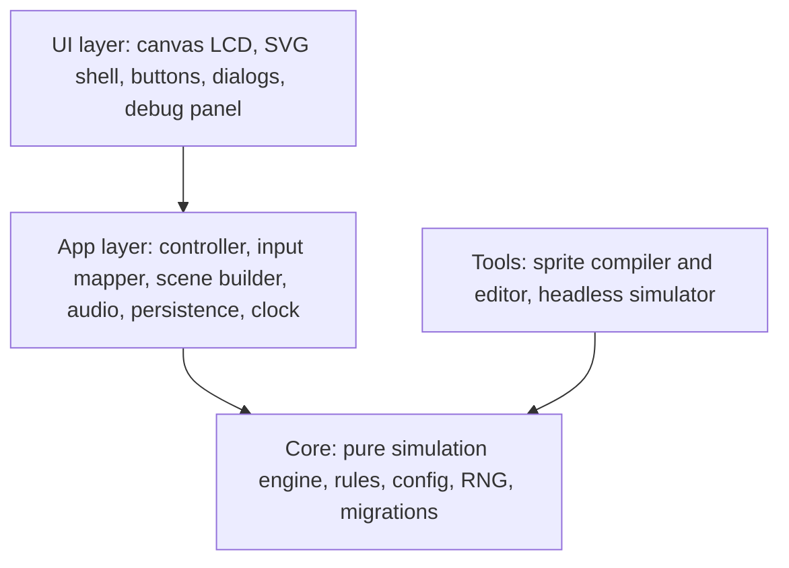
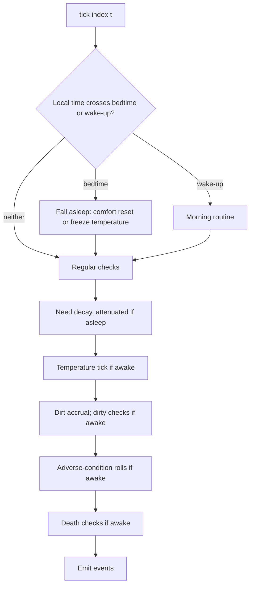
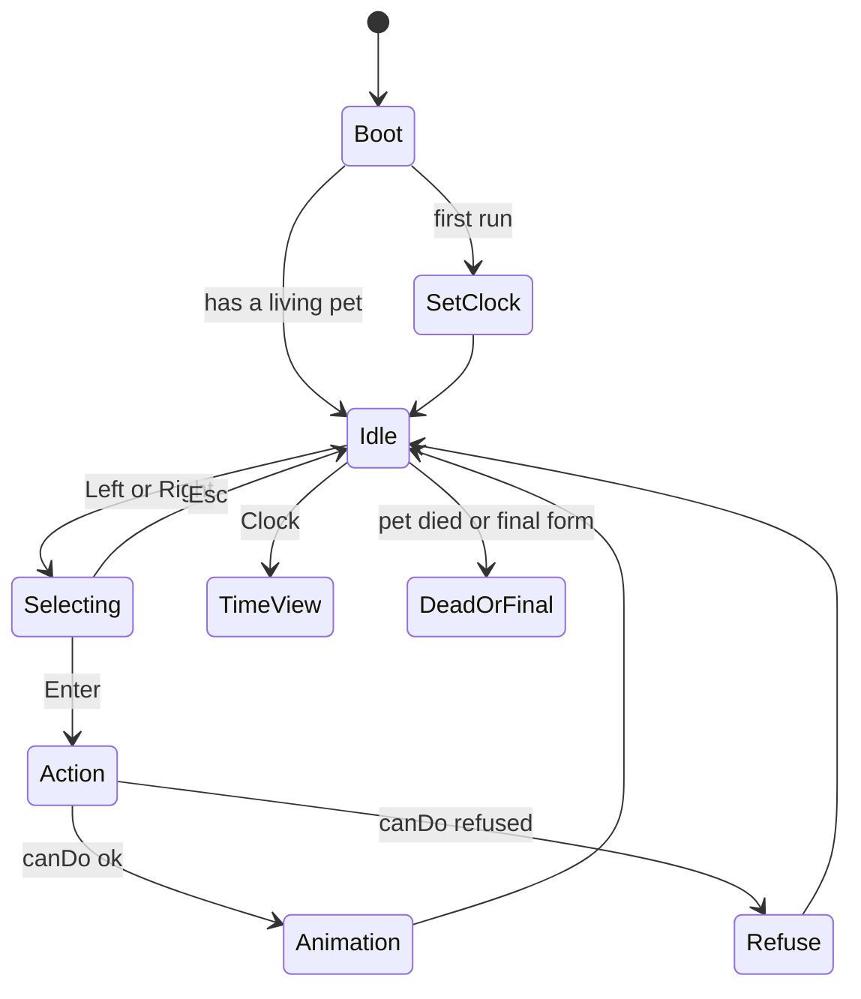

# 13. Architecture & tech stack proposal

Status: **proposal for your approval.** No code exists yet. It is derived from the rules in [08](08-target-rules.md), the catalogue in [11](11-states-and-actions.md), and the art/sound decisions in [10](10-art-spec.md). Decisions I need from you are collected in §13.12.

## 13.1 What the rules demand of the software

| Need (rule) | Consequence for the design |
|-------------|----------------------------|
| Real time, simulated on open for the time away (TIME-01) | A **pure simulation engine** that can advance a pet from `lastCheck` to `now` in one call |
| Fixed 15-minute checks for everything (TIME-06) | The engine is a loop over **15-minute grid ticks** |
| Deterministic regardless of when you open the app (TIME-02) | **Counter-based randomness**, no hidden state (§13.5) |
| Life measured in wake-ups; bedtime by stage; configurable times (TIME-05, SLEEP-05) | Scheduled events (bedtime, wake-up) are **snapped to the same 15-minute grid** |
| 100+ tunable numbers, play-test heavy (§ tuning backlog) | **One typed config object**, overridable at runtime, every value tagged with its rule ID |
| A 15–20-day life can't be tested by waiting (Q-UI-6) | Time is an **injected input**; a debug panel can jump days; a **headless simulator** runs thousands of lives |
| Art arrives in waves; missing sprites fall back (ASSET-04) | **Sprite registry with fallback**, text-bitmap format, compile step |
| No sound files; piezo notes (SND-02) | **Web Audio synth** from note lists |
| Installable, offline, works on phones incl. iOS (README goal) | **PWA** with precached shell, standalone display, durable storage |

## 13.2 Proposed stack

| Concern | Choice | Why / alternative |
|---------|--------|-------------------|
| Language | **TypeScript**, `strict` | The rules are full of small state machines and ranges; types catch mistakes at compile time |
| Build / dev server | **Vite** | Fast, static output, first-class PWA plugin |
| UI framework | **None** (plain TypeScript modules) | The UI is one LCD canvas, ten icon segments, five buttons and a few dialogs. A framework adds weight for no gain. *Alternative: Preact if the settings/menus grow.* |
| LCD rendering | **Canvas 2D**, integer-scaled, `image-rendering: pixelated` | 19 × 16 dots with off-dot "ghosting" and a dimmed "lights off" look are trivial on a canvas |
| Shell + icon segments | **Inline SVG** (original design) | Scales to any screen; each of the 10 segments is a path we toggle; no bitmap shell is needed |
| Localization | **A tiny typed module plus `Intl`**, no library; pt-BR is the source of truth ([14](14-localization.md)) | ~150 strings do not justify a dependency; missing keys become compile errors |
| Sprites | **Text bitmaps** compiled to typed data at build time (§13.7) | As agreed in round 2 |
| Audio | **Web Audio** oscillator, square wave | SND-02 |
| Storage | **IndexedDB** via a tiny key-value wrapper (`idb-keyval`) | More robust than `localStorage`; supports `navigator.storage.persist()`; the data is small JSON |
| PWA | **vite-plugin-pwa** (Workbox, precache) | Manifest + service worker with a "new version available" prompt |
| Tests | **Vitest** (unit + simulation), **Playwright** (smoke + offline) | Same toolchain as Vite; Playwright also checks the PWA installs and works offline |
| Quality | ESLint + Prettier, `tsc --noEmit` in CI | Standard |
| Package manager | **npm** (lockfile committed) | Fewest moving parts |

Dependency policy: **keep runtime dependencies to one** (`idb-keyval`) and dev tooling to Vite, its PWA plugin, Vitest, Playwright, TypeScript and the linter. Fewer dependencies mean a smaller supply-chain surface and easier long-term maintenance for a hobby project.

## 13.3 Layers



- **Core has no DOM, no timers, no storage, no `Date.now()`.** It takes state and a time and returns new state and events. This makes it testable and lets the debug panel and the simulator reuse it.
- **App layer** owns the real world: the clock, storage, audio context, and the UI state machine (which screen is showing).
- **UI layer** only draws and forwards button presses.

### Folder layout

```text
rakuraku-dinokun-web/
  docs/                       (this specification)
  src/
    core/
      config/                 tuning.ts (all numbers, tagged with rule IDs), schedule.ts
      rng.ts                  counter-based random (§13.5)
      time.ts                 15-min grid, local time-of-day, wake-up / bedtime
      state.ts                PetState, Settings types, defaults, new-pet factory
      engine.ts               advance(state, toTime): {state, events}
      rules/                  needs.ts temperature.ts dirt.ts sleep.ts sickness.ts
                              death.ts growth.ts species.ts care.ts (stub) weight.ts
      actions/                drink.ts food.ts lamp.ts pet.ts check.ts play.ts
                              educate.ts bath.ts ac.ts medical.ts + canDo guards
      migrations.ts           versioned, non-destructive
    app/
      clock.ts                real clock + debug offset
      controller.ts           glue: input -> action -> engine -> persist -> render
      scene.ts                state + UI mode -> list of sprite layers + segment states
      ui-state.ts             screens as a state machine (§13.8)
      input.ts                buttons, keyboard, chords (hold Esc+Enter, etc.)
      audio.ts                square-wave synth, note-list sounds
      storage.ts              IndexedDB, persist(), schema version
    i18n/
      locales/                pt-BR.ts (defines the Messages type), en.ts, later es-419.ts
      index.ts                t(), plural(), setLocale(), detection; formatting through Intl
    ui/
      shell.svg.ts  lcd.ts  segments.ts  dialogs.ts  debug-panel.ts
    art/                      *.txt text bitmaps (you draw these), sprites.json (generated)
  tools/
    sprites/                  compiler + browser editor/viewer
    sim/                      headless simulator CLI and balance reports
  tests/
    rules/  engine/  actions/  sim/  e2e/
```

## 13.4 The simulation engine

### State

One serializable object per pet (plain JSON, versioned):

| Group | Fields (from the rules) |
|-------|--------------------------|
| Identity | `id`, `name`, `seed`, `bornAt` (UTC ms) |
| Progress | `stage` (egg…final), `wakeUps` (since hatching), `species`, `finalFormAtWakeUp` (drawn 16–20), `finalForm`, `dead` + `deadCause` |
| Meters | `hunger` 0–8, `thirst` 0–8, `happiness` 0–4, `education` 0–4 (E+…A+), `weightKg` |
| Environment | `roomTemp`, `acOn`, `lightOn`, `bumpArmed` (TEMP-14) |
| Sleep | `asleep`, `lastWakeLocalDate` (guards double firing) |
| Condition clocks | `sickSince`, `dirtySince`, `tooHotSince` / `tooColdSince`, `dirtThresholdHours` (drawn), onset delays (drawn), death-check escalation counters, dirty-check escalation counter |
| Counters | species feeding counts (stages 1–2), `overplayCount`, `lossStreak`, `careScore` accumulators (stub) |
| Time | `lastCheckIndex` (the last 15-min tick processed), `actionCounter` (random draws made by actions) |

Global **Settings** are separate: wake-up time (15-min steps, 06:00–09:00), adult bedtime, Jokenpo rounds (3–5), sound on/off, language, and a debug **time offset**.

### `advance(state, toTime)`

For every 15-minute tick between `lastCheckIndex` and `toTime`, in order:



**Morning routine** (WAKE-UP): increment `wakeUps` → apply deferred overnight consequences (the light-on SICK roll SLEEP-02/03, the DIRTY transition DIRT-08, attenuated penalties SLEEP-11) → growth step per the stage table (LIFE) → species decision when arriving at stage 3 (SPEC) → final-form check (LIFE-04) → set `asleep = false`.

Rules of the road:

- Dead or final-form pets **stop simulating** (no ticks after that).
- Ticks are processed **strictly in order**; the 100th tick sees the result of the 99th.
- Within one check the interval that just ended is accounted for first (need decay at the rate of the state the pet was in), then the schedule is applied at that instant (bedtime, wake-up, morning routine). Decay progress is kept in **integers** (840 units per awake check) because floating-point sums drift at exact boundaries.
- The engine returns **events** (`grew`, `gotSick`, `becameDirty`, `died`, `woke`, `beep`, …). The UI uses them for sounds and for a **"while you were away" summary** after a long catch-up.
- A catch-up of 30 days is 2,880 ticks, which is trivial for a modern phone, so it can run synchronously.

### Actions

Each action is `canDo(state, now)` (returns OK or a **refusal reason**: asleep, sick, bath window closed, full, …) plus `apply(state, now)` (returns the new state and events). All refusals share the head-shake outcome. Examples: SICK blocks Drink/Food/Play/Educate/Bath/Pet (SICK-01), sleep allows only Lamp/Check/Clock (SLEEP-09), Bath needs DIRTY or the hour before bedtime (DIRT-06). Jokenpo is played by the UI one round at a time, with the core drawing the pet's choice and applying the game result (PLAY-01…07).

## 13.5 Time and randomness

**The 15-minute grid.** A tick index is `floor(utcMs / 15 min)`. Because the grid is absolute, the same ticks happen whether you open the app now or tomorrow. **All scheduled times are restricted to 15-minute multiples** (wake-up 06:00–09:00 in 15-minute steps; bedtimes 19:00/19:15/19:30…), so every scheduled event falls exactly on a tick. This is the one new constraint I'm asking you to accept (§13.12).

**Local time.** "Wake-up" and "bedtime" are local wall-clock times (TIME-04); elapsed time is UTC. Each tick computes its local time with the standard `Date` API, so daylight-saving changes just work: an event fires once per local day, guarded by `lastWakeLocalDate`. If the device time moves backwards, elapsed = 0 (TIME-04).

**Counter-based randomness.** Instead of a stateful random generator, every random draw is a pure function:

```text
rand(seed, tickIndex, channel)  ->  number in [0, 1)
```

where `channel` names the purpose (`dirtyCheck`, `sickAtWake`, `tempMove`, `deathCheck`, …). Actions use `rand(seed, actionCounter, channel)`. This means:

- opening the app late, early, or in pieces gives **the same outcome** for the same sequence of actions;
- **reloading can't re-roll** a lucky or unlucky draw;
- tests can assert exact results, and the simulator can replay a life.

Values "drawn once" (the final-form wake-up 16–20, the dirt threshold 16–20 h, the onset delays 2–3 h / 4–6 h …) are drawn at the moment they become relevant and **stored in the state**.

## 13.6 Configuration and tuning

- `core/config/tuning.ts` is a single typed object. Every number carries the **rule ID** it implements, e.g. `dirty.firstCheckChance: 0.20 // DIRT-09`.
- Profiles: **`classic`** (faithful to the toy) now; a pacing multiplier hook (`timeScale`) exists in the config for the phone-pacing question (Q-BLOG-2) but defaults to 1 (nothing changes unless you decide).
- The debug panel can edit any value live; overrides are stored separately and never touch pet data.
- The tuning backlog in [07](07-open-questions.md) maps 1:1 to keys in this file.

## 13.7 Art and sound pipeline

- **Source:** `src/art/**/*.txt` (the text-bitmap format in [10](10-art-spec.md)); a build step compiles them into `sprites.json` and **fails on malformed frames** (wrong size, ragged rows).
- **Registry with fallback (ASSET-04):** `sprite(form, animation)` returns the exact sprite, or the nearest available (same form's idle, else the previous stage's, else a labelled placeholder). The game is playable with **zero art**, showing text placeholders.
- **Species overlays:** composed at draw time from base frames plus the species overlay with per-frame offsets.
- **Editor/viewer:** `tools/sprites` is a small static page (click dots, preview animations at their frame time, export to the text format). It reads and writes the same files.
- **Sound:** `audio.ts` plays note lists through one square-wave oscillator, unlocked on the first user gesture; mute is a setting. Melodies are data, in `src/core/config` or beside it.

## 13.8 UI state machine



Logical buttons (Left, Right, Enter, Esc, Clock) are the only input the controller sees. The **input layer** maps pointer taps on the SVG buttons and the keyboard to them, and recognizes the chords (hold Esc+Enter, hold Left+Right) if we adopt them (PROP-03/04). The **scene builder** turns `(state, UI mode)` into: the sprite layers to draw on the 19 × 16 grid, which of the ten segments are lit, and any sound to play. Rendering is therefore a pure function and easy to test with snapshots.

## 13.9 Persistence, PWA and the browser's limits

- **Save** after every action and every engine advance, and on `pagehide`. `lastCheckIndex` and `actionCounter` live in the saved state.
- **Schema versioning:** a `schemaVersion` plus an ordered list of migrations. No destructive upgrades (the legacy dropped the table).
- **Durability:** call `navigator.storage.persist()`. Browsers may evict storage for sites that aren't installed; iOS Safari in particular limits storage of non-installed sites. *This must be re-checked when implementing, because browser policies change.* It argues for a clear **"install to your home screen"** prompt, since a 15–20-day life must survive.
- **Running:** in the foreground a 1-second timer asks "is the next tick due?" and advances; on `visibilitychange` / `pageshow` / `focus` it catches up. **No background execution** is assumed.
- **Notifications:** not in v1. Web Push needs a server and, on iOS, an installed PWA; there is no reliable client-only alternative. Decision deferred with Q-BLOG-2.
- **Offline:** service worker precaches everything; the first load needs network, then it works offline.
- **Updates:** a "new version available" banner, so a refresh never happens mid-animation.
- **Export/import** of a pet as JSON (Q-DATA-1) is cheap because the state is plain JSON; planned, not scheduled.

## 13.10 Debug panel and the simulator

**In-app panel** (`?debug=1`, or a hidden gesture): current state viewer; **skip time** (+15 min, +1 h, to next wake-up, +1 day…) using the engine's own `advance`; force conditions (sick, dirty, hot, cold); set meters; edit tuning values; the live **event log**; the care-score accumulators; export/import state. Debug time is a persisted **offset** added to the real clock, with a visible banner, because otherwise a pet advanced into the future would freeze until real time caught up (TIME-04).

**Headless simulator** (`tools/sim`): runs the engine with scripted "players" (diligent / twice-a-day / once-a-day / absent) for thousands of seeded lives and prints **lifespan histograms, causes of death and species mix**. It is how we tune the numbers without waiting days.

## 13.11 Testing strategy

| Layer | What we test |
|-------|--------------|
| Rules | One test file per rule group, naming the rule IDs (SLEEP-03, DIRT-09, …) with exact expected results thanks to counter-based randomness |
| Engine invariants | **Jump equals steps:** advancing 3 days in one call = advancing in many small calls = save/reload in between. Dead and final pets don't change. DST and clock-back cases |
| Pacing (the spec's targets) | PACE-01: two interactions a day keep the pet healthy, one a day triggers conditions, none escalates. DEATH-06: a pet left alone for about 2 days most likely dies. DEATH-05: a never-fed pet dies before wake-up 5 |
| Lifecycle | Growth lands on the right wake-ups (2/5/8/11/15, then 16–20); species rule by diet share; the final form is random in range |
| Actions | Every refusal rule (sick, asleep, bath window, full), every effect |
| Rendering | Scene-builder snapshots; sprite compiler rejects malformed art |
| End to end | Playwright: load, install, go offline, reload, interact; storage survives a reload |

CI runs type-check, lint, unit tests, the simulator's invariants, and the e2e smoke.

## 13.12 Decisions I need from you

| # | Decision | My recommendation |
|---|----------|-------------------|
| A1 | Stack: TypeScript + Vite, **no UI framework**, Canvas LCD + SVG shell, IndexedDB, Vitest/Playwright | ✅ approved |
| A2 | **Counter-based randomness** (outcomes independent of when you open the app) | ✅ approved |
| A3 | **Snap all scheduled times to 15-minute multiples** (wake-up, bedtimes) | ✅ approved |
| A4 | Name for the project and the app | ✅ **Dinkie Dino** (you will buy a domain). Both historical names belonged to 90s bootleg toys, in your words; the art stays original ([12 §12.5](12-blog-guide-review.md)) |
| A5 | Source license for the new code | ✅ MIT (`LICENSE`, © 2026 Leonardo Pereira) |
| A6 | Initialise a **git repository** in `rakuraku-dinokun-web` now | ✅ done (no commits yet) |
| A7 | **Hosting** | ✅ **GitHub Pages** (see §13.15) |
| A8 | Multiple pets (4 slots) vs. a single pet like the real toy (Q-UI-3). The data model supports N either way | ⏳ not answered; proceeding with my recommendation: single pet for v1, model ready for N |
| A10 | **Localization approach** (round 13): a tiny typed module plus `Intl`, no library; pt-BR source of truth; en alongside; es-419 later ([14](14-localization.md)) | ⏳ proposed |
| A9 | Phone pacing (Q-BLOG-2): keep `timeScale` at 1 for now | ⏳ not answered; proceeding with `timeScale = 1` |

## 13.13 Milestones

| # | Milestone | Done when |
|---|-----------|-----------|
| M0 | Scaffold: repo, Vite + TS, lint, tests, CI | ✅ done: typecheck, lint, format, tests and build pass locally; the CI workflow is written but has not run yet (no GitHub repo) |
| M1 | **Core engine, part 1**: time grid, counter-based RNG, state, needs decay, sleep/wake, growth, final form | ✅ done: 67 tests, including the lifecycle timeline and jump = steps. Rules covered: TIME-01/02/04/05/06, LIFE-01…05/07, SLEEP-01/05/06/07/11 (attenuation), NEED-01, PACE-01 (decay rates are provisional until M3), CARE-01 (stub) |
| M2 | **Core engine, part 2**: temperature/AC, dirt, sickness, death, species, weight, all actions | ✅ done in four commits (actions and species; health; temperature and AC; Jokenpo, weight and conditions): 219 tests and a mutation check of every rule group. Not yet done: the care score (CARE-02 is deferred), pet name/seed generation, migrations, and the pacing numbers, which M3 tunes |
| M3 | **Simulator and tuning**: headless runs, pacing and death targets | ✅ done: `npm run sim` ([15](15-pacing-report.md)), 250 tests incl. the PACE-01 and DEATH-05/06 targets. Needs rates tuned; three findings need your decision (temperature pacing, bath rhythm, one missed day) |
| M4 | **UI shell**: SVG shell, LCD canvas, buttons, keyboard, scene builder, audio synth, placeholder art, **the i18n module with the pt-BR and en catalogs** ([14](14-localization.md)) | Playable end to end with text placeholders |
| M5 | **Persistence and PWA**: IndexedDB, migrations, catch-up summary, service worker, install prompt | Close the app for a day, reopen: pet advanced correctly; works offline |
| M6 | **Debug panel and config overrides** | You can jump days and force states while play-testing |
| M7 | **Sprite pipeline and editor**; integrate wave 1 art | Your small-blob frames render; fallback works |
| M8 | Polish: onboarding clock, settings, reset flow, accessibility, update flow | Release candidate |
| M9 | Later: art waves 2–5, notifications decision, pacing profiles, export/import | |

M1–M3 need **no art and no UI**, so the hardest, most rule-dependent part gets built and verified first, while you draw wave 1.

## 13.14 Edge cases the engine must define (collected from the rules)

These are small, but each needs an explicit rule before M2; proposed defaults in brackets.

1. **Hatching at night** while the pet should be asleep [**implemented in M1:** it starts asleep and wakes at the next wake-up time, which counts as wake-up 1, as in LIFE-02's edge case. Hatching in the evening before bedtime starts awake].
2. **Initial values** at hatch: meters, room temperature (25 °C), AC off, light on or off [half-full meters; light off].
3. **Changing the wake-up time** (TIME-05) [applies from the next wake-up].
4. **Changing the Jokenpo rounds** mid-game [applies to the next game].
5. **Death or final form** while the app is closed [shown when reopened, with the event summary].
6. **Reset** while a pet is alive [needs the long-press + confirmation (RESET-03)].
7. **Clock set backwards or time zone travel** [elapsed 0; wake/bed fire once per local day].

## 13.15 Deploying to GitHub Pages

Yes: a static PWA is a good fit. What to know:

- **HTTPS** is provided and enforced, which service workers require.
- **Source = GitHub Actions.** In the repo's *Settings → Pages*, choose "GitHub Actions". The workflow `.github/workflows/deploy-pages.yml` (already written) tests, builds and publishes `dist/` on every push to `main`.
- **Base path.** A project site lives at `https://<user>.github.io/<repo>/`, so the build uses `VITE_BASE=/<repo>/` (computed from the repo name). With a **custom domain** the site is at the root: set the repository variable `PAGES_BASE` to `/`, and add the domain in *Settings → Pages* (GitHub writes a `CNAME` for the Actions flow; with DNS you point the domain at GitHub as described in its docs).
- **Pick the final address before anyone plays.** Saved pets live in IndexedDB, which is **per origin**. Moving from `<user>.github.io/<repo>` to your own domain starts with an empty save; the only bridge is the JSON export/import (Q-DATA-1). So buy the domain first, or schedule export/import before launching publicly.
- **Verify the domain** in your GitHub account's Pages settings to prevent someone else claiming it if the DNS record is ever left dangling.
- **Caching.** Pages sets a short cache lifetime. Vite fingerprints asset names, and the service worker's "new version available" prompt (M5) handles updates, so this is fine.
- **Cost / limits.** Free for public repositories, as far as I know; private-repository Pages needs a paid GitHub plan, so check the current terms. The site size and bandwidth limits are far above what this app needs.
- **Not provided:** no server code, so no Web Push (already out of v1 scope).
- **Not done yet:** there is no GitHub repository, so nothing is published. Creating it and pushing are outward-facing actions that I'll only do when you ask.

